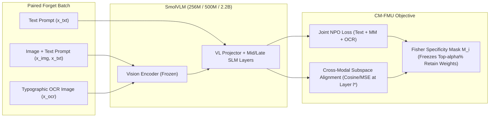

# Research Execution Blueprint: Cross-Modal Machine Unlearning in Small Vision-Language Models (sVLMs)

**Target Venue:** [MULVA 2026](https://mulva-2026.github.io/mulva-2026/index.html) (1st Workshop on Machine Unlearning for Language, Vision and AI @ ICVGIP 2026)  
**Target Timeline:** 10–12 Days (Single Researcher / Engineer)  
**Compute Budget:** 1x NVIDIA A100 GPU (40GB or 80GB VRAM, BF16 + FlashAttention-2)  
**Working Titles:**
1. *The Multimodal Bottleneck: Cross-Modal Superposition and Surgical Unlearning in Small Vision-Language Models*
2. *Where Does Forgotten Knowledge Hide? Mechanistic Localization and Entanglement-Aware Unlearning in Compact VLMs*

---

## 1. Executive Summary & Core Thesis

Machine unlearning aims to selectively erase specific facts, entities, or private profiles from trained models without retraining from scratch. While most existing unlearning methods are designed and evaluated on 7B–70B models, real-world edge deployments rely on **Small Language and Vision-Language Models (sVLMs, 250M–2B parameters)**.

This project investigates and solves two compounding failure modes unique to **Small VLMs**:
1. **The Capacity Bottleneck (Cross-Task Superposition):** Because compact models have narrow residual streams and fewer parameters, the same MLP neurons and attention heads encode *both* target factual associations (to be forgotten) and general visual-linguistic reasoning (to be retained). Standard unlearning updates cause severe **utility collapse** as model size shrinks from `2.2B` down to `256M`.
2. **Cross-Modal Knowledge Bleed (Visual Resurrection):** Unlearning an entity via text-only prompts leaves visual pathways intact. Providing the entity's face image—or a typographic image containing the entity's name (OCR prompt)—acts as a high-salience activation steering vector that bypasses text-only unlearning and **resurrects "forgotten" textual biographies**.

> [!IMPORTANT]
> **Key Contribution:** We provide (1) the first controlled scaling analysis (`256M`, `500M`, `2.2B`) of unimodal vs. multimodal unlearning, (2) a mechanistic Fisher-overlap localization showing how cross-modal entanglement scales inversely with model size, and (3) **Cross-Modal Fisher-Masked Unlearning (CM-FMU)**, a lightweight method that prevents visual resurrection while preserving general VQA utility.

---

## 2. Unified Experimental Stack (Zero-Friction Setup)

To complete all experiments within 8 days of compute/coding, the entire project uses **one unified model family** and **one dataset** that natively supports both text-only and multimodal evaluation.

### 2.1 Model Family (`SmolVLM`)
All three models share the exact same HuggingFace `AutoProcessor` and `AutoModelForVision2Seq` architecture, differing only in backbone scale:
* **Scale 1 (Ultra-Compact):** `HuggingFaceTB/SmolVLM-256M-Instruct` (256M params)
* **Scale 2 (Edge):** `HuggingFaceTB/SmolVLM-500M-Instruct` (500M params)
* **Scale 3 (Standard Small):** `HuggingFaceTB/SmolVLM-Instruct` (2.2B params)

*(Note: Because `SmolVLM` accepts both pure-text prompts and interleaved `[Image + Text]` prompts, the same checkpoints are used for both Text-SLM scaling experiments and Cross-Modal VLM experiments.)*

### 2.2 Dataset & Benchmark (`CLEAR`)
* **Dataset:** **CLEAR** (*Character Unlearning in Multimodal Models*, built directly on top of the **TOFU** benchmark; HuggingFace ID: `CaptionEmporium/CLEAR`).
* **Contents:**
  * **200 Fictitious Authors** with 4,000 pure-text QA pairs (from TOFU) + 3,770 generated face/persona images and visual QA pairs.
  * **Standard Splits:** `forget01` (1% authors), `forget05` (5% authors), `forget10` (10% authors), paired with `retain99`, `retain95`, `retain90`, plus `real_authors` and `world_facts` general utility splits.
* **Synthetic Attack Extension (Typographic OCR Probe):**
  * A 15-line Python `PIL` script that renders each forgotten author's name as text inside an image (`224x224` white canvas with black text) paired with a generic text prompt: *"Give a detailed biography of the author named in this image."*

---

## 3. Evaluation Metrics

Every unlearned checkpoint is evaluated across **4 metrics** (computed via batch generation + teacher-forced forward passes):

1. **Text Forget Efficacy ($\text{FE}_{\text{txt}} \downarrow$):** ROUGE-L recall and Truth Ratio on text-only QA pairs of the Forget set (lower = better forgetting).
2. **Multimodal Forget Efficacy ($\text{FE}_{\text{mm}} \downarrow$):** ROUGE-L recall and Truth Ratio when prompted with `[Author Face Image] + Text Question` on the Forget set.
3. **Cross-Modal Resurrection Rate ($\text{CMRR} \downarrow$):**
   $$\text{CMRR} = \frac{\text{ROUGE-L}(\text{Unlearned Model on Image+Text / OCR Probe})}{\text{ROUGE-L}(\text{Base Finetuned Model on Text})}$$
   Measures how much "forgotten" knowledge is recovered when switching from text queries to visual/OCR queries.
4. **Model Utility ($\text{MU} \uparrow$):** Harmonic mean of ROUGE-L / Accuracy across (a) Retain Set Text QA, (b) Retain Set Visual QA, and (c) General Real-World VQA (`world_facts` / `real_authors`).

---

## 4. Technical Methodology

### 4.1 Baselines to Implement
All baselines run for 5 epochs with LoRA ($r=16, \alpha=32$) or full-parameter tuning on the LLM backbone + connector (`lr = 2e-5`, `batch_size = 16`, BF16):
1. **GradDiff (Gradient Difference):**
   $$\mathcal{L}_{\text{GD}} = \mathcal{L}_{\text{CE}}(\mathcal{D}_{\text{retain}}) - \gamma \mathcal{L}_{\text{CE}}(\mathcal{D}_{\text{forget}})$$
2. **NPO (Negative Preference Optimization):**
   $$\mathcal{L}_{\text{NPO}} = -\frac{2}{\beta} \mathbb{E}_{(x,y) \in \mathcal{D}_{\text{forget}}} \left[ \log \sigma \left( -\beta \log \frac{\pi_\theta(y|x)}{\pi_{\text{ref}}(y|x)} \right) \right] + \mathcal{L}_{\text{CE}}(\mathcal{D}_{\text{retain}})$$
3. **RMU (Representation Misdirection for Unlearning):**
   Pushes hidden states $h_\ell(x)$ at mid-layer $\ell$ on $\mathcal{D}_{\text{forget}}$ toward a scaled random unit vector $c \cdot u$, while keeping $h_\ell(x)$ close to $\pi_{\text{ref}}$ on $\mathcal{D}_{\text{retain}}$.

Each baseline is tested under **two training regimes**:
* **Unimodal Text Unlearning (`Text-Only`):** Unlearning loss is computed *only* on text QA pairs $\mathcal{D}_{\text{forget}}^{\text{txt}}$.
* **Naive Multimodal Unlearning (`MM-Naive`):** Unlearning loss is computed on both $\mathcal{D}_{\text{forget}}^{\text{txt}}$ and $\mathcal{D}_{\text{forget}}^{\text{mm}}$ across all trainable parameters.

---

### 4.2 Mechanistic Diagnostic: Cross-Modal Fisher Entanglement
Before unlearning, we quantify parameter superposition across model scales (`256M`, `500M`, `2.2B`).
For any dataset split $\mathcal{D} \in \{\mathcal{D}_{\text{forget}}^{\text{txt}}, \mathcal{D}_{\text{forget}}^{\text{mm}}, \mathcal{D}_{\text{retain}}^{\text{mm}}\}$, we compute the empirical diagonal Fisher Information score for every weight $w_i \in \theta$ over 1 pass of the data:
$$F_i(\mathcal{D}) = \frac{1}{|\mathcal{D}|} \sum_{(x, y) \in \mathcal{D}} \left( \frac{\partial \mathcal{L}_{\text{CE}}(x, y; \theta)}{\partial w_i} \right)^2$$

From these importance vectors, we compute two layer-wise diagnostics:
1. **Forget-Retain Superposition Score (Capacity Bottleneck):**
   $$\text{Overlap}_\ell(\text{Forget}, \text{Retain}) = \text{Jaccard}\Big(\text{Top-}k\%(F_\ell(\mathcal{D}_{\text{forget}}^{\text{mm}})),\, \text{Top-}k\%(F_\ell(\mathcal{D}_{\text{retain}}^{\text{mm}}))\Big)$$
2. **Cross-Modal Circuit Overlap:**
   $$\text{Overlap}_\ell(\text{Text}, \text{Vision}) = \text{Jaccard}\Big(\text{Top-}k\%(F_\ell(\mathcal{D}_{\text{forget}}^{\text{txt}})),\, \text{Top-}k\%(F_\ell(\mathcal{D}_{\text{forget}}^{\text{mm}}))\Big)$$

---

### 4.3 Proposed Method: Cross-Modal Fisher-Masked Unlearning (CM-FMU)



**CM-FMU** upgrades standard NPO with two lightweight mechanisms:

1. **Fisher Specificity Gradient Masking (Prevents Utility Collapse in Small Models):**
   * Freeze the Vision Encoder completely.
   * For all remaining parameters in the Vision-Language Connector and SLM layers, compute the **Retain-to-Forget Specificity Ratio**:
     $$S_i = \frac{F_i(\mathcal{D}_{\text{retain}}^{\text{mm}})}{F_i(\mathcal{D}_{\text{forget}}^{\text{mm}}) + \epsilon}$$
   * Construct a binary gradient mask $M_i = \mathbb{I}\big(S_i < \text{Quantile}_{1-\alpha}(S)\big)$ that zeroes out gradients during backpropagation on the top $\alpha\%$ (e.g., $\alpha = 30\%$) most retain-critical weights:
     $$\theta^{(t+1)} = \theta^{(t)} - \eta \left( M \odot \nabla_\theta \mathcal{L}_{\text{CM-FMU}} \right)$$

2. **Cross-Modal Representation Alignment Loss (Eliminates Visual/OCR Resurrection):**
   * For each forgotten entity $e \in \mathcal{D}_{\text{forget}}$ with paired text input $x_{\text{txt}}$ and multimodal input $x_{\text{mm}} = (x_{\text{img}}, x_{\text{txt}})$, extract the last-token hidden state at the middle SLM layer $\ell^*$ (e.g., $\ell^* = \lfloor L/2 \rfloor$).
   * Enforce that the visual pathway cannot diverge from the unlearned text pathway by aligning both toward the unlearned representation:
     $$\mathcal{L}_{\text{align}} = \mathbb{E}_{(x_{\text{txt}}, x_{\text{mm}}) \in \mathcal{D}_{\text{forget}}} \Big[ 1 - \cos\big(h_{\ell^*}(x_{\text{mm}}; \theta),\, \text{sg}[h_{\ell^*}(x_{\text{txt}}; \theta)]\big) \Big]$$
   * **Total Objective:**
     $$\mathcal{L}_{\text{CM-FMU}} = \mathcal{L}_{\text{NPO}}(\mathcal{D}_{\text{forget}}^{\text{txt}} \cup \mathcal{D}_{\text{forget}}^{\text{mm}}) + \lambda_{\text{retain}} \mathcal{L}_{\text{CE}}(\mathcal{D}_{\text{retain}}^{\text{mm}}) + \lambda_{\text{align}} \mathcal{L}_{\text{align}}$$

---

## 5. Repository Structure to Build

```text
svlm-unlearning/
├── configs/
│   └── default.yaml              # Hyperparameters, model IDs, alpha, lambda
├── data/
│   ├── clear_loader.py           # Loads CLEAR dataset (Text QA, VQA, Retain splits)
│   └── ocr_generator.py          # Generates PIL typographic images for OCR probe
├── models/
│   └── wrapper.py                # Unified SmolVLM loader + middle-layer hook registration
├── unlearning/
│   ├── baselines.py              # GradDiff, NPO, RMU implementations
│   ├── fisher.py                 # Computes F_i(D), Jaccard overlap heatmaps, and binary mask M
│   └── cm_fmu.py                 # Proposed CM-FMU trainer (Fisher mask hook + L_align)
├── eval/
│   └── evaluate.py               # Computes FE_txt, FE_mm, CMRR, and Model Utility (MU)
├── scripts/
│   ├── 01_finetune_base.sh       # Finetunes 256M, 500M, 2.2B on CLEAR full dataset
│   ├── 02_run_baselines.sh       # Runs Text-Only & MM-Naive baselines across scales
│   ├── 03_compute_fisher.sh      # Generates mechanistic entanglement data & heatmaps
│   └── 04_run_cm_fmu.sh          # Runs main method + alpha/lambda ablations
└── plots/
    └── generate_paper_plots.py   # Outputs Figures 2, 3, and 4 as PDFs
```

---

## 6. Day-by-Day Execution Schedule (11 Days on 1x A100)

### Phase 1: Pipeline & Base Model Preparation (Days 1–2)
* **Day 1 — Data & Evaluation Harness:**
  * Implement `data/clear_loader.py` and `data/ocr_generator.py`.
  * Implement `eval/evaluate.py` and verify it runs on off-the-shelf `SmolVLM-256M-Instruct` in < 2 minutes on A100.
  * **Deliverable:** Working evaluation script outputting JSON metrics (`FE_txt`, `FE_mm`, `CMRR`, `MU`).
* **Day 2 — Target Memorization Fine-Tuning:**
  * Run `scripts/01_finetune_base.sh` to fine-tune `SmolVLM-256M`, `500M`, and `2.2B` on the full CLEAR dataset (Text + Image splits) for 5 epochs (`bf16=True`, `batch_size=32`, `lr=5e-5`).
  * Verify that all three base models achieve >80% ROUGE-L on both Text and Multimodal Forget splits.
  * **Compute Time:** ~2.5 A100 hours total.
  * **Deliverable:** Saved checkpoints `checkpoints/base_{256M,500M,2.2B}`.

### Phase 2: Diagnosis Experiments — Scaling & Cross-Modal Bleed (Days 3–4)
* **Day 3 — Implement & Run Baselines (`forget05` and `forget10`):**
  * Implement `GradDiff`, `NPO`, and `RMU` in `unlearning/baselines.py`.
  * Launch `scripts/02_run_baselines.sh` across all 3 model scales under both `Text-Only` and `MM-Naive` regimes.
  * **Compute Time:** 3 models $\times$ 3 methods $\times$ 2 splits $\times$ 2 regimes = 36 runs ($\sim 4\text{ mins}$ each) = **~2.5 A100 hours**.
* **Day 4 — Evaluate & Verify Diagnostic Findings:**
  * Run `eval/evaluate.py` across all 36 checkpoints, including the Typographic OCR probe.
  * **Deliverable:** Raw CSV/JSON numbers for **Table 1** (proving `Text-Only` unlearning suffers high `CMRR` when queried with faces/OCR, and `MM-Naive` suffers severe `MU` collapse in `256M` and `500M`).

### Phase 3: Mechanistic Localization (Days 5–6)
* **Day 5 — Fisher Importance Accumulation:**
  * Implement `unlearning/fisher.py` to accumulate squared gradients over 1 epoch (no optimizer step) on $\mathcal{D}_{\text{forget}}^{\text{txt}}$, $\mathcal{D}_{\text{forget}}^{\text{mm}}$, and $\mathcal{D}_{\text{retain}}^{\text{mm}}$.
  * Save layer-wise top-$10\%$ parameter indices and mask tensors for `256M`, `500M`, and `2.2B`.
  * **Compute Time:** ~30 minutes on A100.
* **Day 6 — Entanglement Analysis & Heatmap Generation:**
  * Compute Jaccard overlap across Vision Encoder, Connector, and SLM layers (Early, Middle, Late).
  * **Deliverable:** **Figure 3** (Layer-wise heatmap showing (a) `Forget-Retain` overlap increases sharply as model size shrinks from `2.2B` to `256M`, and (b) `Text-Vision` overlap peaks in the Connector and middle SLM layers).

### Phase 4: Proposed Method (CM-FMU) & Ablations (Days 7–8)
* **Day 7 — Implement & Run CM-FMU:**
  * Implement `unlearning/cm_fmu.py` by registering PyTorch `register_hook` on parameter gradients (`grad * mask`) and adding $\mathcal{L}_{\text{align}}$ at the middle SLM layer $\ell^* = \lfloor L/2 \rfloor$.
  * Run CM-FMU across `256M`, `500M`, and `2.2B` on `forget05` and `forget10`.
  * **Compute Time:** ~1.5 A100 hours.
* **Day 8 — Hyperparameter Ablations:**
  * Run sensitivity sweeps on `SmolVLM-500M` (`forget10`):
    1. Mask sparsity $\alpha \in \{0\%, 15\%, 30\%, 45\%, 60\%\}$.
    2. Alignment weight $\lambda_{\text{align}} \in \{0, 0.1, 0.5, 1.0\}$.
    3. Unlearning module scope: `SLM-Only` vs. `Projector-Only` vs. `Projector + Masked SLM`.
  * **Deliverable:** Complete metrics for **Table 2** and **Figure 4** (Ablation plots).

### Phase 5: Paper Writing & Visual Polish (Days 9–11)
* **Day 9 — Figures & Tables Lock-In:**
  * Finalize LaTeX tables (**Table 1**: Main Comparison across 3 Scales; **Table 2**: Component & Module Ablations).
  * Generate all PDF plots (`plots/generate_paper_plots.py`) with consistent colorblind-safe palettes.
  * Write **Section 3 (Methodology)** and **Section 4 (Experimental Setup & Results)**.
* **Day 10 — Full Manuscript Draft:**
  * Design **Figure 1** (Teaser diagram illustrating Cross-Modal Resurrection + Fisher-Masked Subspace Alignment).
  * Write **Section 1 (Introduction)**, **Section 2 (Related Work)**, and **Section 5 (Mechanistic Analysis)**.
* **Day 11 — Internal Review & Camera-Ready Formatting:**
  * Write **Abstract** and **Conclusion**.
  * Add a qualitative appendix/figure showing side-by-side model outputs (Base vs. Text-NPO vs. Naive-MM-NPO vs. CM-FMU on Face QA and OCR attacks).
  * Format in the official MULVA / ICVGIP 2026 LaTeX template and verify bibliography completeness.

---

## 7. Checklist of Final Paper Assets (Target: 6–8 Pages)

| Asset | Type | Content / Takeaway Message |
| :--- | :--- | :--- |
| **Figure 1** | Conceptual Diagram | Visualizes how Face/OCR inputs bypass text unlearning in sVLMs and how CM-FMU blocks cross-modal bleed while masking retain-critical neurons. |
| **Figure 2** | Scaling Pareto Curve | Plots *Model Utility ($\uparrow$)* vs. *Multimodal Forget Efficacy ($\downarrow$)* across `256M`, `500M`, `2.2B`—showing steep utility collapse in smaller models under standard unlearning, rescued by CM-FMU. |
| **Figure 3** | Mechanistic Heatmaps | Layer-wise Jaccard overlap of top-10% Fisher parameters: (Left) `Forget vs. Retain` across model scales; (Right) `Text Forget vs. Visual Forget` across layers. |
| **Table 1** | Main Results Table | Comprehensive comparison of `GradDiff`, `NPO`, `RMU` (Text-Only & MM-Naive) vs. `CM-FMU` across `256M`, `500M`, `2.2B` on `forget05` and `forget10` (`FE_txt`, `FE_mm`, `CMRR`, `MU`). |
| **Figure 4 & Table 2** | Ablation Studies | Impact of Fisher Mask ratio $\alpha$, $\mathcal{L}_{\text{align}}$ weight $\lambda_{\text{align}}$, and module freezing choices. |
| **Figure 5** | Qualitative Examples | Real model generations showing an author's face and OCR image resurrecting biographical facts after Text-NPO, whereas CM-FMU refuses/erases cleanly while answering a general VQA prompt accurately. |
